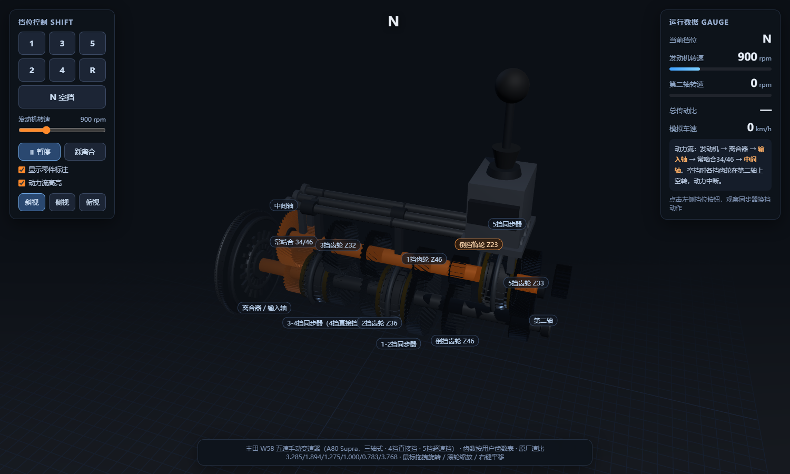
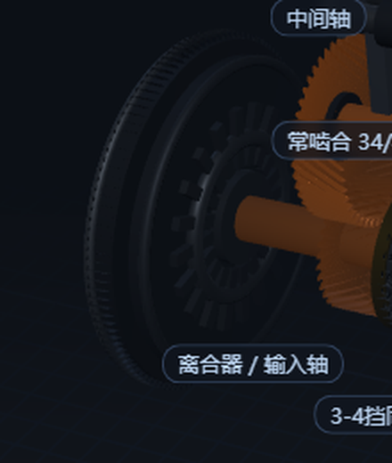
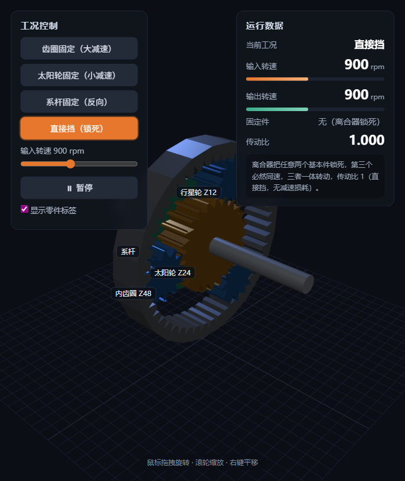
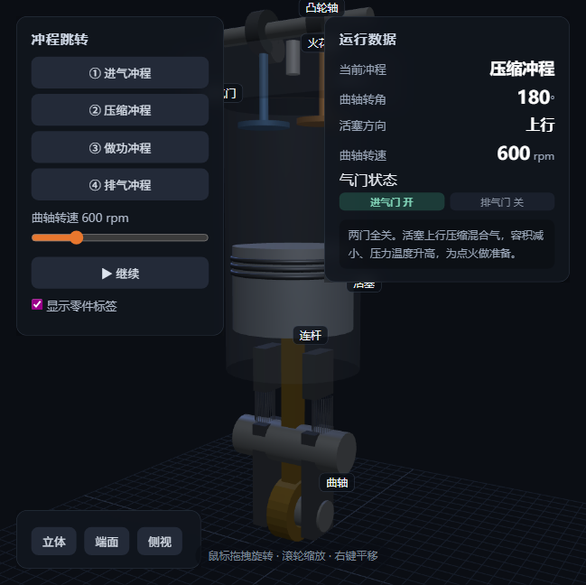

# CAD Mechanism Animator

> 把任意 CAD/STP/STEP 机械装配模型，变成**可在浏览器交互、可离线双击打开**的工作原理动画。

给一个机械 3D 模型（变速箱、发动机、差速器、泵、曲柄连杆、凸轮、机器人关节……），
本项目提供一套**可复用的 Skill + 脚本 + 模板**，帮你把它"拆解 → 提参数 → 重建 → 让它动起来"，
最终产出一个单文件 HTML，无需服务器、无需联网，双击即可演示。

## 为什么需要它

直接把 CAD（B-rep）丢进网页有三个问题：**文件太重**（几十上百 MB）、**没有运动信息**（零件是静态的）、
**无法表达传动关系**。本项目的思路是：**解析装配 → 提取关键参数 → 参数化轻量重建 → 建立运动学 → 交互打包**。

## 特性

- **通用流程**：一套 5 阶段方法论，覆盖绝大多数机械机构
- **参数自动提取**：从 STP 自动测量齿轮齿数（FFT + 数峰）、齿顶圆、齿宽、螺旋角、中心距
- **参数化重建**：渐开线直齿/斜齿齿轮、轴、同步器、连杆、壳体，轻量可动
- **运动学引擎**：齿轮副、外啮合反向、空套齿轮、同步器锁死、直接挡、超速挡、惰轮、多工况状态机
- **交互演示**：挡位/工况切换、OrbitControls、零件标签、实时仪表（转速/传动比/车速）、动力流高亮
- **离线单文件**：所有 ES module 内联为 Blob URL，`file://` 双击即用

## 示例：丰田 W58 五速手动变速器（A80 Supra）

由一个 75 MB 的变速箱 STP 装配，最终生成约 1.4 MB 的单文件交互动画：



- 三轴式布局，6 个工况（N / 1–5 / R），4 挡直接挡、5 挡超速挡、倒挡经惰轮反向
- 同步器换挡、空套齿轮、动力流高亮、H 型换挡杆联动
- 飞轮含启动齿圈与放射膜片弹簧：



## 示例 2：行星齿轮组（周转轮系）

太阳轮、内齿圈、3 个行星轮与系杆，演示固定不同基本件得到的 4 种传动：



- **齿圈固定**：太阳轮→系杆，i=3.000（大减速）
- **太阳轮固定**：齿圈→系杆，i=1.500（小减速）
- **系杆固定**：太阳轮→齿圈，i=−2.000（反向，倒挡原理）
- **直接挡**：锁死任意两件，i=1.000

核心公式（转化轮系）：`(ωs−ωc)/(ωr−ωc) = −zr/zs`，且 `zr = zs + 2·zp`。

## 示例 3：四冲程发动机（曲柄滑块 + 配气）

单缸四冲程发动机，演示曲轴、连杆、活塞、进排气门、凸轮轴与火花塞的协同：



- 曲柄滑块：活塞销位置 `y = R·cosθ + √(L²−R²·sin²θ)`，连杆按曲柄销摆角定位
- 四冲程循环：进气 → 压缩 → 做功 → 排气，凸轮轴以曲轴**半速**驱动进排气门
- 燃烧室气体随冲程变色（进气蓝 / 压缩黄 / 做功橙红 / 排气灰），火花塞在点火时刻闪光
- 可一键跳转任意冲程，实时显示曲轴转角、活塞方向与气门开闭状态

## 快速开始

### 方式一：直接看示例（最简单）

双击打开任意一个单文件示例：
- [`examples/gearbox/W58变速器演示.html`](examples/gearbox/W58变速器演示.html)
- [`examples/planetary/行星齿轮组演示.html`](examples/planetary/行星齿轮组演示.html)
- [`examples/engine/四冲程发动机演示.html`](examples/engine/四冲程发动机演示.html)

或运行模板演示：

```bash
cd examples/template-demo
python -m http.server 8000
# 浏览器打开 http://localhost:8000/template.html
```

### 方式二：用模板做你自己的机构

1. 复制 [`skill/assets/template.html`](skill/assets/template.html)，它内置一个"双轴 + 啮合齿轮 + 空套齿轮"最小示例
2. 按文件内 `【替换区】` 注释，替换三处：**机构定义 → 运动学 → 装配**
3. 浏览器打开调试，最后打包成单文件：

```bash
python skill/scripts/build_single.py your-app.html -o 演示.html
```

### 方式三：从 CAD 模型提取参数

```bash
# 1) 提取所有零件实例的世界坐标与包围盒
python skill/scripts/extract_instances.py 总装配.STP -o instances.json

# 2) 测量齿轮齿数/齿顶圆/齿宽/螺旋角（gears.json 列出实例 id 与轴中心）
python skill/scripts/measure_gears.py 总装配.STP gears.json -o gear_params.json
```

依赖：`pip install cadquery`（含 OpenCascade Python 绑定）。

## 方法论：5 阶段

| 阶段 | 做什么 | 关键产物 |
|---|---|---|
| **0 读懂机构** | 识别固定件/输入/输出、运动副、工况 | 运动传递链 |
| **1 解析 CAD** | 遍历装配树，提取实例坐标/包围盒 | `instances.json` |
| **2 提取参数** | 测齿数/齿顶圆/齿宽/螺旋角/行程 | `gear_params.json` |
| **3 参数化重建** | 用参数生成轻量几何 | Three.js 场景 |
| **4 建立运动学** | 运动副、传动比、状态机 | 主循环逻辑 |
| **5 交互打包** | 仪表、标签、高亮、Blob 单文件 | 单文件 HTML |

详细方法论见 [docs/methodology.md](docs/methodology.md)；
齿轮几何见 [skill/references/gear-geometry.md](skill/references/gear-geometry.md)；
各机构运动学见 [skill/references/kinematics.md](skill/references/kinematics.md)。

## 举一反三：常见机构速查

| 机构 | 运动副 | 关键规律 |
|---|---|---|
| 齿轮变速箱 | 转动 + 齿轮副 + 移动(拨叉) | 齿数、传动比、同步器锁死、空套、惰轮 |
| 曲柄滑块 | 转动 + 转动副 + 移动 | x≈r·cosθ+√(l²−r²sin²θ) |
| 凸轮机构 | 转动 + 移动(从动件) | 升程轮廓、基圆、压力角 |
| 差速器 | 锥齿轮 + 行星架 | ωL+ωR=2ω架 |
| 带/链传动 | 转动 + 挠性件 | 轮径比、线速度相等、同向 |
| 行星齿轮组 | 多齿轮副 + 系杆 | (ωs−ωc)/(ωr−ωc)=−zr/zs |
| 泵/压缩机 | 转动/移动 + 容积周期 | 转子相位、排量周期、进排出口 |

## 目录结构

```
cad-mechanism-animator/
├── README.md
├── LICENSE
├── skill/                      # 可复用 Skill（可直接放入 Agent 的 skills 目录）
│   ├── SKILL.md
│   ├── scripts/
│   │   ├── extract_instances.py   # 装配实例提取
│   │   ├── measure_gears.py       # 齿轮参数测量
│   │   └── build_single.py        # 单文件打包
│   ├── references/
│   │   ├── gear-geometry.md       # 齿轮几何
│   │   ├── kinematics.md          # 各机构运动学
│   │   └── troubleshooting.md     # 踩坑排查
│   └── assets/
│       └── template.html          # 通用交互模板
├── examples/
│   ├── gearbox/                # 变速箱完整案例（W58）
│   ├── planetary/              # 行星齿轮组案例
│   ├── engine/                 # 四冲程发动机案例
│   └── template-demo/          # 模板 + three.js 离线库
└── docs/
    └── methodology.md
```

## 技术栈

- [Three.js](https://threejs.org/) r160（WebGL 渲染、OrbitControls、CSS2DRenderer）
- [OpenCascade](https://dev.opencascade.org/)（经 cadquery/OCP，解析 STEP/B-rep）
- 纯 Python 打包脚本，无额外构建工具

## 许可证

[MIT License](LICENSE)

## 贡献

欢迎提交更多机构案例（发动机、差速器、泵、机器人关节……）与改进。
提 Issue 或 PR 即可。
